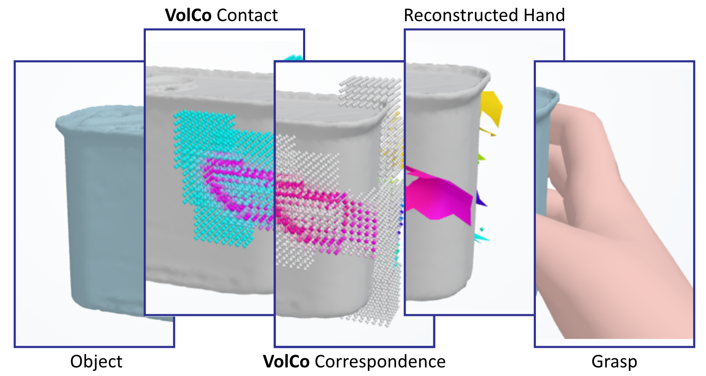

# Volumetric Contact

This is the official implementation of the NeurIPS 2026 paper "VolCo: Volumetric Contact for High-Fidelity Human Grasp Generation".



VolCo has three modules, trained separately:

| Module | What it learns | Entry point | Config |
| --- | --- | --- | --- |
| **VolumeVAE** | Encodes the hand-object contact inside one local volume on the object surface | `scripts/train_volume_vae.py` | `config/volume_vae.yaml` |
| **HandVAE** | Encodes hand vertices into a global hand latent | `scripts/train_handvae.py` | `config/handvae.yaml` |
| **VolCoDiff** | Diffusion model that generates the volume and hand latents for a given object | `scripts/train_diffusion.py` | `config/volcodiff_128_8.yaml` |

VolumeVAE and HandVAE are independent of each other; both must be trained (or downloaded) before VolCoDiff.

## Contents

- [Environment](#environment)
- [Data](#data)
- [Pretrained models](#pretrained-models)
- [Training](#training)
- [Evaluation](#evaluation)
- [Citation](#citation)

## Environment

The code is tested with Python 3.10, CUDA 12.4, PyTorch 2.5.1, PyTorch3D 0.7.8 and Kaolin 0.18.0 on Linux.

```bash
conda create -n volco python=3.10 -y
conda activate volco

# PyTorch
pip install torch==2.5.1 torchvision==0.20.1 --index-url https://download.pytorch.org/whl/cu124

# PyTorch3D (built from source; see https://github.com/facebookresearch/pytorch3d/blob/main/INSTALL.md)
pip install "git+https://github.com/facebookresearch/pytorch3d.git@v0.7.8" --no-build-isolation

# Kaolin
pip install kaolin==0.18.0 -f https://nvidia-kaolin.s3.us-east-2.amazonaws.com/torch-2.5.1_cu124.html

# Remaining dependencies
pip install -r requirements.txt
pip install git+https://github.com/mattloper/chumpy        # needed to read the MANO model files
pip install git+https://github.com/lixiny/manotorch
```

All commands below are run from the repository root with the root on the Python path:

```bash
export PYTHONPATH=$PWD
```

## Data

### MANO

Download MANO v1.2 from the [MANO website](https://mano.is.tue.mpg.de) (registration required) and place it as:

```text
data/misc/mano_v1_2/models/MANO_RIGHT.pkl
```

The other files in `data/misc/` (`closed_mano_r_faces.npy`, `hand_geo_dist_matrix.npy`) and the hand surface embedding (`common/model/hand_cse/hand_cse_4.ckpt`) are included in the repository.

### GRAB

1. Download the GRAB dataset and the GRAB object meshes (`tools/object_meshes`) from the [GRAB website](https://grab.is.tue.mpg.de) (registration required).
2. Process them for grasp synthesis with the GrabNet preprocessing script of the [GRAB repository](https://github.com/otaheri/GRAB) (`grab/grab_preprocessing.py`), with its output folder at `data/grab` (or link it there).

The code reads only the following files:

```text
data/grab/
├── obj_info.npy        # object meshes and their 1024 surface samples
├── sbj_info.npy        # subject hand templates
├── train/
│   ├── grabnet_train.npz
│   └── frame_names.npz
├── val/
│   ├── grabnet_val.npz
│   └── frame_names.npz
└── test/
    ├── grabnet_test.npz
    └── frame_names.npz
```

### HO-3D objects (optional)

For evaluation on the HO-3D objects, place the YCB object models used by [HO-3D](https://github.com/shreyashampali/ho3d) as `data/ycb_objects/models/<object>/textured_simple.obj` and add `data=ho3d_multi_contact` to the evaluation command.

### Preprocessing

All remaining preprocessing runs automatically through the data modules' `prepare_data()` the first time you train or evaluate, and is skipped once the results exist. Everything is written to `data/preprocessed/<dataset>/`:

| Output | Produced by | Used by | Time |
| --- | --- | --- | --- |
| `obj_hulls/<object>/hull_*.stl` — convex decomposition of each object ([CoACD](https://github.com/SarahWeiii/CoACD)) for the simulation metric | both data modules | all modules | ~1 min per object |
| `simplified_obj_mesh.pkl` — objects decimated to 2000 faces | both data modules | all modules | < 1 min |
| `local_grid_points_10.0mm/` — the local volumes (object point, frame) with the hand inside, sampled per frame | VolumeVAE data module | VolumeVAE | ~1 min |
| `msdf_128_8_10mm/`, `msdf_adj_points_128_8_10mm/` — the object's multi-scale SDF and its local grid adjacency | VolCoDiff data module | VolCoDiff | a few min |

The convex hulls of different CoACD versions are not identical, so the simulation metric can differ slightly from the paper if you regenerate them.

## Pretrained models

You can download our pretrained model to reproduce the results in the paper:

| Model | Download | Place at |
| --- | --- | --- |
| VolumeVAE (128 volumes, 8³ grid) | [volume_vae/best_128_8.ckpt](TODO) | `logs/checkpoints/volume_vae/best_128_8.ckpt` |
| HandVAE (16-d latent) | [hand_vae/latent16.ckpt](TODO) | `logs/checkpoints/hand_vae/latent16.ckpt` |
| VolCoDiff (128 volumes, 8³ grid) | [volcodiff/best_128_8.ckpt](TODO) | `logs/checkpoints/volcodiff/best_128_8.ckpt` |

Optionally, you can download the smaller models, which takes less memory at a cost of performance degredation:

| Model | Download | Place at |
| --- | --- | --- |
| VolumeVAE (64 volumes, 4³ grid) | [volume_vae/best_64_4.ckpt](TODO) | `logs/checkpoints/volume_vae/best_64_4.ckpt` |
| VolCoDiff (64 volumes, 4³ grid) | [volcodiff/best_64_4.ckpt](TODO) | `logs/checkpoints/volcodiff/best_64_4.ckpt` |

These are the default paths in the configs. A VolCoDiff checkpoint also contains the VolumeVAE and HandVAE weights it was trained with, so evaluation needs only the VolCoDiff checkpoint.

## Training

All scripts are configured with [Hydra](https://hydra.cc): any config value can be overridden on the command line, e.g. `train.batch_size=32` or `trainer.devices=[1]`.

**Logging.** By default (`debug=true`) runs are logged to TensorBoard under `logs/tb_logs/`. Pass `debug=false` to log to [Weights & Biases](https://wandb.ai) instead (run `wandb login` first); W&B runs are saved under `logs/wandb_logs/`.
Each run keeps its 3 best checkpoints and the last one.

### 1. VolumeVAE

```bash
python scripts/train_volume_vae.py
```

- Trains on 1 GPU (`trainer.devices=[0]`) for 100 epochs.
- Checkpoints are saved in the logger's run folder (`logs/tb_logs/lightning_logs/version_*/` or `logs/wandb_logs/<project>/<run id>/checkpoints/`).
- For the 64-volume, 4³-grid model, add `msdf=64_4 ae=volume_vae_64latent`.

### 2. HandVAE

```bash
python scripts/train_handvae.py
```

- Trains on 1 GPU for 200 epochs.
- Checkpoints are saved in `logs/checkpoints/handvae/16latent/`.

### 3. VolCoDiff

VolCoDiff loads and freezes the VolumeVAE and HandVAE weights given by `ae.pretrained_weight` and `hand_ae.pretrained_weight`. Either copy your checkpoints to the default paths in [Pretrained models](#pretrained-models) or pass them explicitly:

```bash
python scripts/train_diffusion.py \
    ae.pretrained_weight=<path to VolumeVAE ckpt> \
    hand_ae.pretrained_weight=<path to HandVAE ckpt>
```

- Trains with DDP on 2 GPUs (`trainer.devices=2`) for 100 epochs; use `trainer.devices=1` for a single GPU.
- Checkpoints are saved in the logger's run folder (`logs/tb_logs/<run name>/version_*/` or under `logs/wandb_logs/`).
- To resume, add `train.resume_ckpt=<path to last.ckpt>`.
- For the 64-volume, 4³-grid model, use `--config-name volcodiff_64_4` (with the matching VolumeVAE).

## Evaluation

Generate grasps for the GRAB test objects and evaluate them:

```bash
python scripts/train_diffusion.py run_phase=test trainer.devices=1 debug=false \
    ckpt_path=logs/checkpoints/volcodiff/best_128_8.ckpt
```

For each test object, VolCoDiff samples `test.n_samples` (default 20) grasps; the hand pose is then fitted to the generated volumetric contact (`pose_optimizer=hybrid`). The following metrics are computed in parallel on the CPU:

| Metric | Description |
| --- | --- |
| Simulation Displacement | Object displacement (cm) in a PyBullet simulation under gravity |
| Penetration Depth | Maximum depth (cm) of hand vertices inside the object |
| Intersection Volume | Hand-object intersection volume (cm³), voxelized at 1 mm |
| Contact Area | Object surface area in contact with the hand (cm²) |
| Contact Ratio | Fraction of grasps that touch the object |
| IV/CA | Intersection Volume / Contact Area per grasp |
| Entropy, Cluster Size | Diversity of the generated grasps |

**Results.**

- The per-object average of each metric is printed after each object.
- With `debug=false`, the final metrics over all objects (mean, std, min, max, plus diversity and inference time) are logged to W&B, together with a per-object table.
- A turntable video per grasp is written to `tmp/process_vid/`. It shows the hand recovered from the generated contact, the final hand, the contact volumes, and the hand sampled by VolCoDiff before fitting.
- The generated hands are cached in `tmp/grab/`. Add `test.use_cache=true` to recompute the metrics from this cache without sampling again.

**Options.**

- `test.n_samples=<N>`: number of grasps per object.
- `seed=<seed>`: random seed (default 1987).
- `test.vis_result=false`: skip the videos.
- `vis_backend=pytorch3d` (default): renders on the GPU without a display. `vis_backend=open3d` uses Open3D and needs a display.
- `data=ho3d_multi_contact`: evaluate on the HO-3D objects.
- `--config-name volcodiff_64_4 ckpt_path=logs/checkpoints/volcodiff/best_64_4.ckpt`: evaluate the 64-volume, 4³-grid model.

## Citation

If you find our work useful, please cite:

```bibtex
@inproceedings{chen2026volco,
    author = {Chen, Zhuo and Cheng, Yihua and Leonardis, Aleš and Chang, Hyung Jin},
    title = {VolCo: Volumetric Contact for High-Fidelity Human Grasp Generation},
    booktitle = {The Fortieth Annual Conference on Neural Information Processing Systems (NeurIPS)},
    year = {2026}
}
```

## TODOs

- [ ] Update the MSDF preprocessing scripts;
- [ ] Publish the model to HuggingFace.